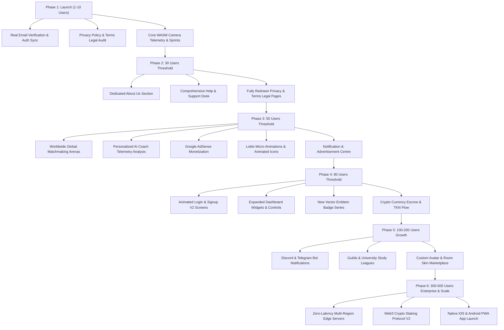

# 🚀 CronoBash Master Product Roadmap & Scale Plan (`biggyplan.md`)

Welcome to the official master scaling plan for **CronoBash / Focus Arena**. This document outlines the technical, UI/UX, feature, and monetization milestones as our user base grows from **1 to 500 active focus fighters**.

---

## 📊 Scale Flowchart (1 to 500 Users Milestone Roadmap)

---

## 🗺️ Milestone Breakdown & Feature Roadmap

### 🟢 Phase 1: Launch Baseline (1 – 10 Users)
> **Primary Focus:** Stability, Auth Accuracy, Core WASM Vision, and Basic Compliance.

- [x] **Core Features Active:** 1v1 Focus Arenas, Squad Study Rooms, Stopwatch/Pomodoro Timer, Feynman Flashcards, Spaced Repetition, Eisenhower Matrix.
- [ ] **Real Email Verification:** Enforce email confirmation links via Supabase Auth for new signups.
- [ ] **Initial Policy Review:** Review Privacy Policy and Terms of Service for initial user onboarding.
- [ ] **Client Telemetry Optimization:** Ensure sub-second latency for local MediaPipe WASM camera gaze tracking.

---

### 🟡 Phase 2: 30 Active Users Milestone
> **Primary Focus:** Brand Identity, Dedicated Support, and Legal Refinement.

- [ ] **Dedicated "About Us" Section:** Interactive founder story, mission timeline, and team section.
- [ ] **Complete Support & Help Desk:** Ticket submission system, live FAQ search, and direct contact portal (`support@cronobash.com`).
- [ ] **Redrawn Privacy & Terms:** Overhauled legal policy pages tailored to global user data protection (GDPR & CCPA guidelines).

---

### 🟠 Phase 3: 50 Active Users Milestone
> **Primary Focus:** Global Arena Matchmaking, AI Intelligence, Micro-Animations, and Ad Monetization.

- [ ] **Global Matchmaking Arenas:** Connect focus fighters from around the world in real-time 1v1 duels with auto-latency routing.
- [ ] **Personalized AI Coach Telemetry Analysis:** AI Coach analyzes weekly distraction heatmaps and generates custom study advice.
- [ ] **Google AdSense Integration:** Non-intrusive banner and video rewards integration for revenue generation.
- [ ] **Lottie Micro-Animations:** Add animated icons across buttons, level-up cards, and timer controls for premium UI/UX.
- [ ] **Notification & Advertisement Centre:** In-app notification drawer for squad invites, tournament announcements, and sponsor deals.

---

### 🔴 Phase 4: 80 Active Users Milestone
> **Primary Focus:** Next-Gen UI/UX, Animated Auth, Token Escrow & Crypto Currency Flow.

- [ ] **Animated Login & Signup V2:** Interactive 3D Spline / canvas animations on login and signup pages.
- [ ] **Dashboard Upgrade V2:** Custom drag-and-drop widget layouts and advanced productivity charts.
- [ ] **New Vector Emblem Badge System:** Redrawn Level 1–100 badges with glowing particle effects.
- [ ] **Crypto Currency & TKN Flow:** Enable token staking, focus yield rewards, and wallet balance withdrawals (`/wallet`).

---

### 🟣 Phase 5: 100 – 200 Users Scale
> **Primary Focus:** Community Retention, Squad Leagues, and Marketplace Monetization.

- [ ] **100 Users:** Discord & Telegram bot integration for instant study notifications and streak reminders.
- [ ] **150 Users:** Automated weekly email digest reports with focus stats, productivity ratios, and squad rankings.
- [ ] **200 Users:** Guilds & University Study Leagues (Inter-college focus tournaments) and Custom Avatar/Theme Marketplace.

---

### 🏆 Phase 6: 300 – 500 Users Master Scale
> **Primary Focus:** Multi-Region Infrastructure, Web3 Escrow Protocol, and Mobile Apps.

- [ ] **300 Users:** Multi-region WebSocket edge relay servers (US, EU, ASIA) for zero-latency global squad sync.
- [ ] **400 Users:** Anti-Cheat AI V2 (Advanced head-pose detection & dual-device webcam verification).
- [ ] **500 Users:** Full Web3 Crypto Staking Escrow protocol, Enterprise Institutional Hubs, and iOS/Android PWA App store deployment.

---

*CronoBash Master Scaling Plan (`biggyplan.md`) created on August 5, 2026.*
